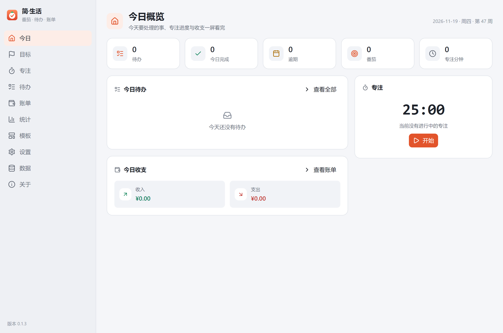
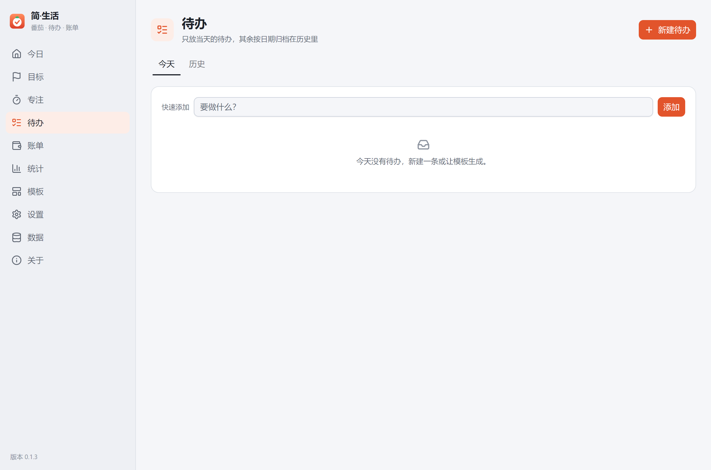
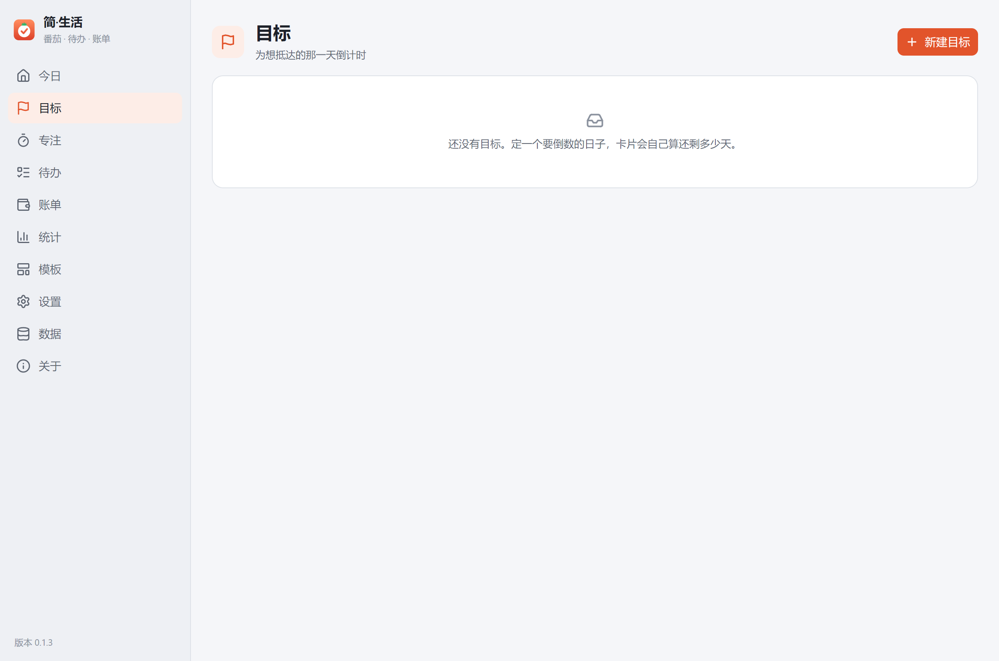
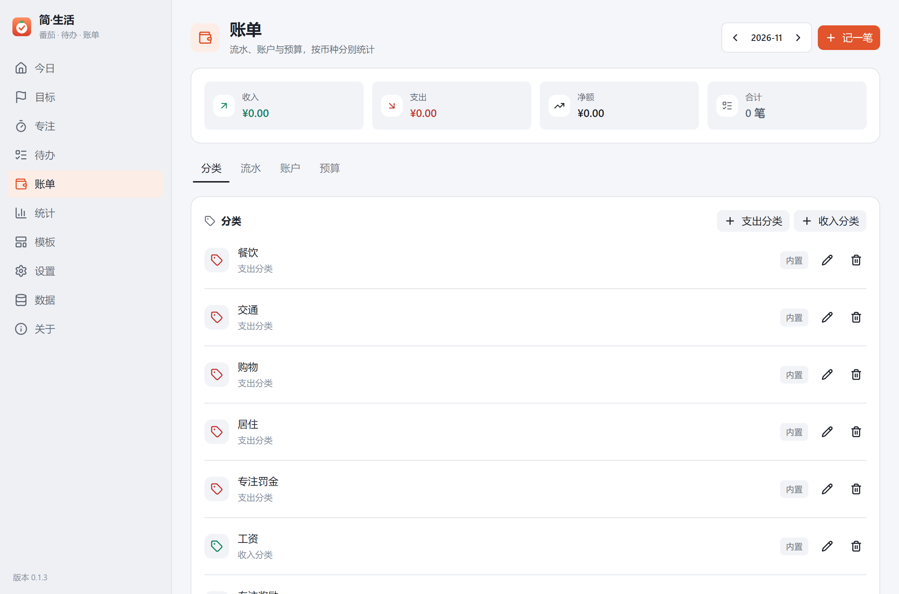
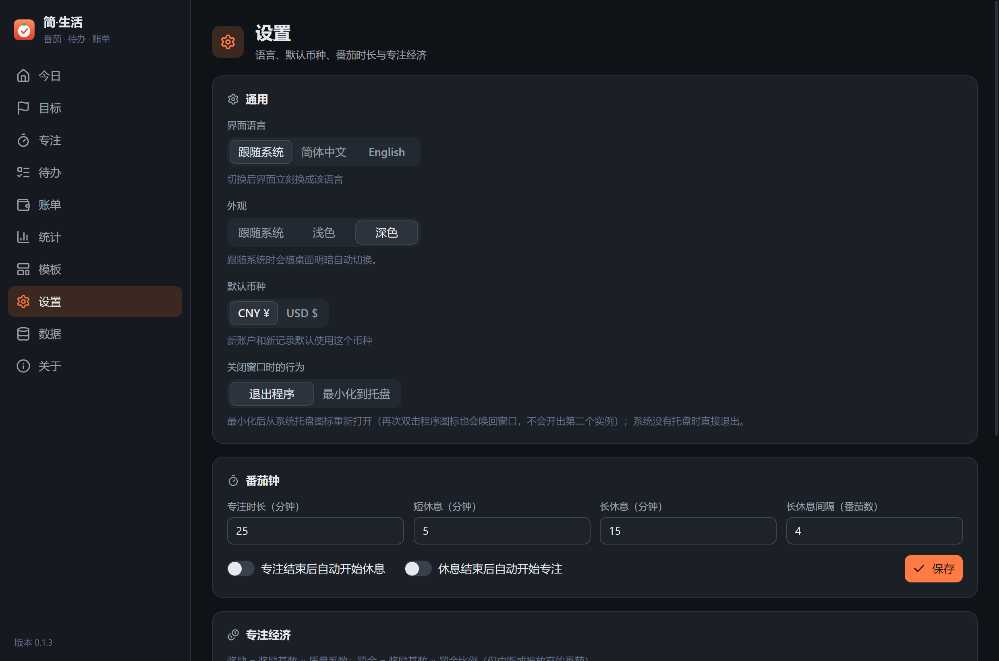

<div align="center">
  <p>English | <a href="README.zh-CN.md">简体中文</a></p>

  <p>
    <a href="assets/readme/home.png"></a>
  </p>
  <p><sub>Today: the day&rsquo;s todos, pomodoro progress and money at a glance &mdash; read only.</sub></p>
</div>

SimpleLife (简·生活) is a Windows desktop app that keeps one day in one window:
countdown goals, todos, a pomodoro timer and a ledger. Everything it knows lives
in a single SQLite file next to the executable — no account, no sync, no
analytics.

<table>
  <tr>
    <td width="50%" valign="top">
      <a href="assets/readme/tasks.png"></a>
    </td>
    <td width="50%" valign="top">
      <a href="assets/readme/goals.png"></a>
    </td>
  </tr>
  <tr>
    <td width="50%" valign="top">
      <a href="assets/readme/ledger.png"></a>
    </td>
    <td width="50%" valign="top">
      <a href="assets/readme/settings-dark.png"></a>
    </td>
  </tr>
</table>

## Why SimpleLife?

<table>
  <tr>
    <td width="50%" valign="top">
      <p><strong>One day, one window.</strong> Goals, the day's todos, the pomodoro
      that is running and the money that moved. A dashboard that only reads, so a
      misclick cannot open an editor on a page that will not draw it.</p>
    </td>
    <td width="50%" valign="top">
      <p><strong>Focus that pays.</strong> A finished pomodoro earns a reward and an
      abandoned one costs a penalty, at the rate you set, capped per day. The
      ledger is where it lands.</p>
    </td>
  </tr>
  <tr>
    <td width="50%" valign="top">
      <p><strong>Local by construction.</strong> Data is <code>datas/simplelife.db</code>
      beside the executable: copy the folder, back up the database, delete it when
      you are done. Nothing leaves the machine.</p>
    </td>
    <td width="50%" valign="top">
      <p><strong>Pure Go, no cgo, no browser.</strong> A native window through
      <a href="https://vivaui.dev/zh/docs/getting-started/">Viva</a>, SQLite through
      <code>modernc.org/sqlite</code>. There is nothing to install but the exe.</p>
    </td>
  </tr>
</table>

Chinese and English interfaces, a light and a dark appearance that can follow the
system, and CNY and USD kept apart: two currencies are summarised separately and
never added together.

## Install

Windows only, for now. Download
`simplelife-<version>-windows-amd64.zip` from the releases page, unpack it and
run `simplelife.exe`.

- Windows 10 or later, 64-bit.
- The build is not code-signed, so SmartScreen warns on first run.
- The program is portable: `simplelife.exe` plus the `datas/` folder it creates.
  There is no installer and no registry entry.
- One instance per user. Starting `simplelife.exe` again hands the command line to
  the copy that is already running and brings its window forward, including from
  the status area.

## Quick start

1. **Tasks &rarr; New** &mdash; write the todo, pick a priority and, if you like, how
   many pomodoros it is worth and how long one of them is.
2. Press **Start** on the row. The row becomes a countdown with pause, finish and
   give up, and the same session appears under **Focus**.
3. When it finishes, the todo is marked done and the reward is booked into the
   ledger.
4. **Ledger** &mdash; record what the day cost. Categories, accounts and monthly
   budgets are the other three tabs.
5. **Templates** &mdash; save a todo that should come back: every day, on weekdays,
   on the 1st, on a given date, or every N days.
6. **Data** &mdash; choose tables and columns, export to CSV, XLSX or Markdown, and
   read the same files back in.

## Features

### Goals

A goal is a name, a note and two dates. The card draws how much of the span has
passed and how many days are left, and says whether it is running, nearly over or
finished. Rename it, move its dates, delete it.

### Tasks

Today's todos, with subtasks, priority, an estimate in pomodoros, the length of
one pomodoro for that todo, and tags. A finished todo stays on today, struck
through, and also appears under **History**, where sections are titled by date
&mdash; never "today". Todos for another day, and todos without a date, are archived
there too. A template writes one todo, not a list.

### Focus

25, 35 or 55 minutes, or a length of your own; 25 by default. A todo's own length
wins when the session is attached to one. Short and long breaks, a system
notification at the end, and the reward or penalty booked automatically.

### Ledger

Four tabs &mdash; **Categories, Entries, Accounts, Budgets** &mdash; over CNY and
USD, month by month.

- Categories can be renamed, added and removed; the seeded ones stay.
- Accounts can be renamed and removed too; a seeded account and any account with
  entries are protected, and the currency and opening balance are fixed once
  created.
- Budgets can be added, edited and removed, and a new ceiling is listed at once,
  before anything is spent.
- An entry&rsquo;s date can be typed or picked from a calendar.

### Stats

Pomodoros, focus time and the money trend over the last 7, 14 or 30 days, or a
range you choose. Changing the range shows that it is counting instead of drawing
old bars under new dates.

### Data

Export picks the tables and the columns, then writes CSV, XLSX or Markdown;
several tables in CSV or Markdown leave as a zip. The preview says which sheet is
which. Import reads those files back, matching on `id` (or name for categories and
accounts), reports per-line failures and is safe to repeat. Account balances and
focus sessions are export-only: a balance is a sum of entries, and a session
cannot be rebuilt without the todo it was bound to.

### Settings

Language, appearance (system / light / dark), default currency, what the close
button does (quit, or hide to the status area), pomodoro defaults, and the focus
economy. The first close to the status area explains itself once and remembers
that it did; on a desktop with no status area the option is not offered and
closing quits.

## Build from source

Go 1.27+, bash and [just](https://github.com/casey/just). No C compiler:
`CGO_ENABLED=0` builds and runs the whole thing.

```sh
just doctor     # toolchain and data folder
just run        # build into build/, then run (database in build/datas/)
just check      # formatting, version, vet, dependency direction, all tests
just test-ui    # presentation layer only, headless
just smoke      # real program, real database: 261 commands, 38 screenshots
just cover      # coverage report -> build/coverage.html
```

`just smoke` builds with `-tags vivahead` and drives the app through Viva's
headless transport, asserting every reply, the accessibility names and the layout
it screenshots into `build/smoke/`. `just instance-check` is the one test that
needs a real desktop: it starts the program, hides the window, starts it again and
asserts that the second process exits and the first comes forward.

Packaging goes through Viva, which also strips the symbols and marks the exe as a
GUI program, so no console window appears:

```sh
just build    # -> dist/simplelife-<version>-windows-amd64.zip (holds simplelife.exe)
```

### Versions

`viva.toml` is the only place a version is written. The Go constant is generated
from it, and three gates keep them equal:

```sh
just update-version 0.2.0   # edit viva.toml, regenerate internal/buildinfo/version.go
just version                # print it
just version-check          # fail if the generated file is behind (also inside `just check`)
```

## Architecture

Go on [Viva](https://vivaui.dev/zh/docs/getting-started/): no Electron, no embedded
browser, no JavaScript. `internal/bootstrap` is the only place that knows how the
layers are assembled.

| Path | Contents |
| --- | --- |
| `cmd/simplelife` | process entry point; `main` calls `bootstrap.Run` |
| `internal/domain` | task, focus, ledger, goal, template, export, update, shared |
| `internal/application` | use cases: depends on the domain and on ports only |
| `internal/contracts` | ports: repositories, clock, ids, notifier, power |
| `internal/infrastructure` | adapters: SQLite, encoders and decoders, update feed, clock, notifications |
| `internal/presentation` | Viva pages, i18n catalogues, formatting, theme |
| `internal/apptest` | test harness: frozen clock, in-memory store, fixtures |
| `assets` | the committed icon, embedded at run time and written into the exe |
| `scripts`, `justfile` | every engineering task goes through `just` |

`just depcheck` enforces the direction: the domain imports no framework, the
application imports no adapter, and the presentation never imports the
infrastructure (the export encoder arrives through `Deps`).

## Data

- Migrations run at startup; upgrading is nothing to do.
- Whole-database backup: quit the program, then copy `datas/`. A clean exit folds
  the `-wal` log back in, so the folder holds one file.
- The database is `datas/simplelife.db` relative to the executable, whatever the
  working directory is.

## License

[Apache License 2.0](LICENSE).
