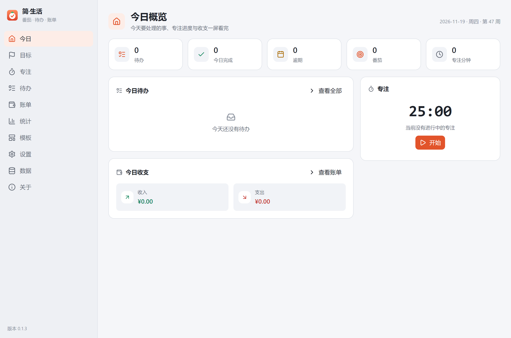
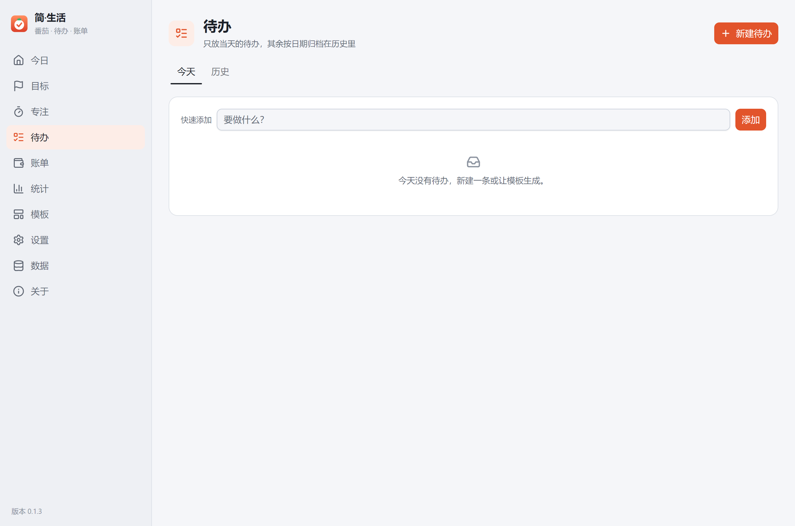
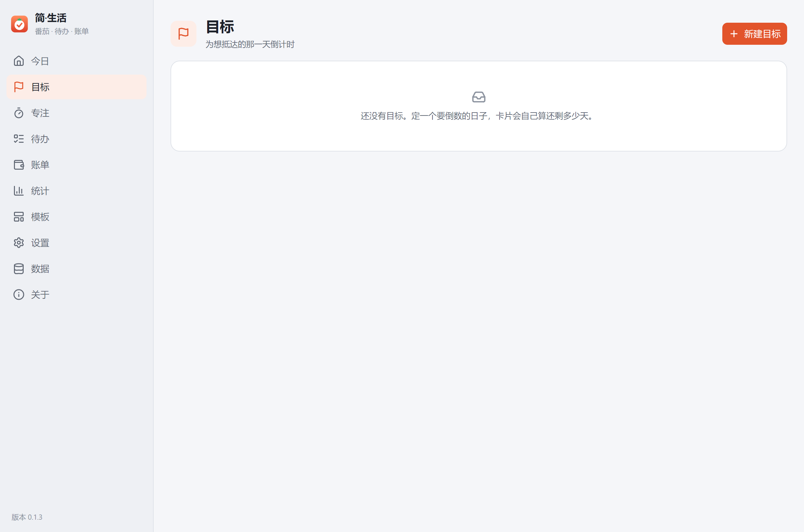
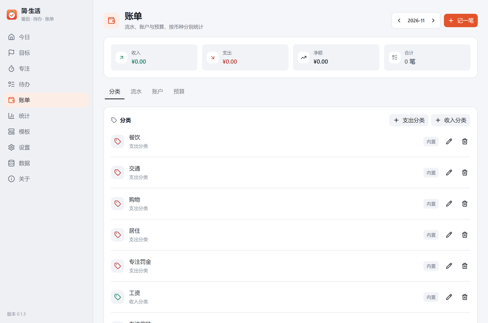
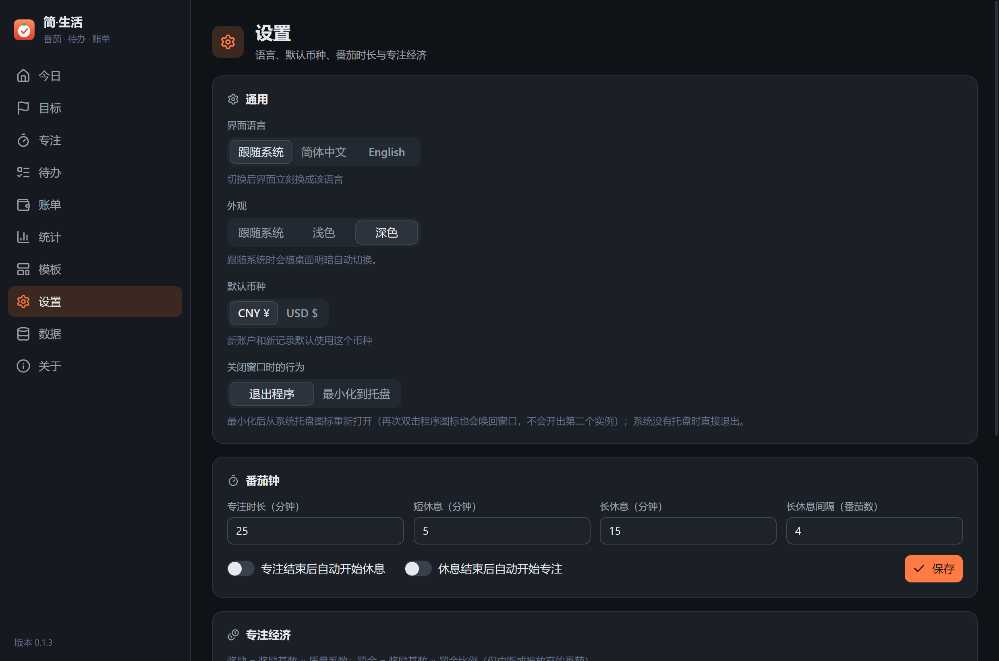

<div align="center">
  <p><a href="README.md">English</a> | 简体中文</p>

  <p>
    <a href="assets/readme/home.png"></a>
  </p>
  <p><sub>今日：当天的待办、番茄进度和收支，一屏看完，只看不改。</sub></p>
</div>

SimpleLife（简·生活）是一个 Windows 桌面程序，把一天放在一个窗口里：倒计时目标、待办、
番茄钟和账本。所有数据都在 exe 旁的同一个 SQLite 文件里——没有账号、没有同步、没有埋点。

<table>
  <tr>
    <td width="50%" valign="top">
      <a href="assets/readme/tasks.png"></a>
    </td>
    <td width="50%" valign="top">
      <a href="assets/readme/goals.png"></a>
    </td>
  </tr>
  <tr>
    <td width="50%" valign="top">
      <a href="assets/readme/ledger.png"></a>
    </td>
    <td width="50%" valign="top">
      <a href="assets/readme/settings-dark.png"></a>
    </td>
  </tr>
</table>

## 为什么是 SimpleLife？

<table>
  <tr>
    <td width="50%" valign="top">
      <p><strong>一天，一个窗口。</strong>目标、当天的待办、正在跑的番茄和动过的钱。
      今日概览只读：误点一下也不会打开一个不属于它的编辑器。</p>
    </td>
    <td width="50%" valign="top">
      <p><strong>专注有代价。</strong>完成的番茄拿奖励，中断或放弃的按你设定的比例罚款，
      还有每日上限；这笔账落进账本。</p>
    </td>
  </tr>
  <tr>
    <td width="50%" valign="top">
      <p><strong>天生本地。</strong>数据就是 exe 旁的 <code>datas/simplelife.db</code>：
      复制目录就是备份，删掉就是清空，什么都留在本机。</p>
    </td>
    <td width="50%" valign="top">
      <p><strong>纯 Go，不要 cgo，不套浏览器。</strong>窗口由
      <a href="https://vivaui.dev/zh/docs/getting-started/">Viva</a> 直接绘制，SQLite 用
      <code>modernc.org/sqlite</code>。除了 exe 什么都不用装。</p>
    </td>
  </tr>
</table>

界面中英双语，浅色 / 深色外观可跟随系统；人民币与美元分开汇总，永不混算。

## 安装

目前只有 Windows：从 releases 下载 `simplelife-<version>-windows-amd64.zip`，
解压后运行 `simplelife.exe`。

- Windows 10 或更高，64 位。
- 构建没有代码签名，首次运行会有 SmartScreen 提示。
- 绿色版：`simplelife.exe` 加上运行后生成的 `datas/`。没有安装器，不写注册表。
- 一个用户同时只跑一份。再点一次 `simplelife.exe` 会把命令行交给已经在跑的那份并把它
  叫到前台，藏在状态区里的窗口也会回来。

## 更新

**关于 → 检查更新**会读取本仓库的最新发布并告诉你有哪个版本，不会自己下载。

按 **安装** 之后按顺序做四件事，任何一步失败就停下：

1. 从发布里下载本平台的压缩包；
2. 用它公布的 SHA-256 校验这个包；
3. 从包里取出 `simplelife.exe`，替换正在运行的 exe——旧文件先改名为
   `simplelife.exe.old`，下次启动时删掉；
4. 重启程序。

没有后台轮询：你不点，它就不联网。替换的只是 exe，`datas/` 原地不动，更新不会碰你的数据。

## 快速开始

1. **待办 → 新建**：写内容、选优先级，可以顺手填预估番茄数和**一个番茄多长**。
2. 在那一行按 **开始**。这一行就地变成倒计时，带暂停 / 完成 / 放弃，同一场专注也出现在
   **专注**页。
3. 跑完这条待办自动标记完成，奖励自动记进账本。
4. **账单**：记下今天花了什么；分类、账户、预算分别在另外三个标签页。
5. **模板**：把要重复的待办存成模板——每天、每周几、每月几号、指定日期，或每 N 天。
6. **数据**：选表、选字段，导出 CSV / XLSX / Markdown；同样的文件也能读回来。

## 功能

### 目标

一个名字、一段备注、起止两个日期。卡片画已过天数占整段的进度，右侧大字写还剩几天，
并区分进行中 / 即将到期 / 已结束，可改名、改日期、删除。

### 待办

今天的待办，带子任务、优先级、预估番茄、**这一条自己的番茄时长**和标签。做完的待办留在
当天并画上删除线，同时进入**历史**——历史的分区标题就是日期，不会是「今天」。别的日期和
没设日期的待办也归档在那里。一个模板只写一条待办，不是一列。

### 专注

25 / 35 / 55 分钟或自定义，默认 25。绑了待办时优先用它自带的时长。有短休息和长休息，
结束弹系统通知，奖励或罚金自动记账。

### 账单

**分类 / 流水 / 账户 / 预算**四个标签页，人民币与美元分开，按月切换。

- 分类可改名、增删；内置分类不可删。
- 账户可改名、可删；内置账户和有流水的账户受保护，币种与初始余额建好后不再改。
- 预算可新增、编辑、删除；新设的上限立刻出现在列表里，不必先花一笔。
- 记账日期可以直接打字，也可以点日历图标挑。

### 统计

近 7 / 14 / 30 天或自定义区间内的专注时长、番茄数与收支趋势。换区间时先显示「正在统计」，
不会拿旧柱子糊新日期。

### 数据

导出先选表和字段，再选 CSV / XLSX / Markdown；CSV 或 Markdown 多表自动打包成 zip，
预览按工作表分块说明。导入会把这些文件读回来，按 `id`（分类、账户按名称）匹配，
逐行报告失败并给出行号，重复导入是安全的。账户余额与专注会话只能导出：余额是流水的汇总，
专注会话离开当时绑定的待办就无法重建。

### 设置

语言、外观（跟随系统 / 浅色 / 深色）、默认币种、**关闭窗口时的行为**（退出 / 最小化到
状态区）、番茄默认值与专注经济。第一次关到状态区会解释一次并记住；桌面没有状态区时不提供
这一项，关闭即退出。

## 从源码构建

需要 Go 1.27+、bash 与 [just](https://github.com/casey/just)。**不需要 C 编译器**：
`CGO_ENABLED=0` 就能构建并运行。三个平台都能构建——`dist/` 里的 Windows 包是交叉编译出来的。

```sh
just doctor     # 检查工具链与数据目录
just run        # 构建到 build/ 后启动（数据库在 build/datas/）
just check      # 格式、版本、vet、依赖方向、全部测试
just test-ui    # 只跑表现层的无头用例
just smoke      # 真实程序 + 真实数据库：261 条命令、38 张截图
just cover      # 覆盖率报告 -> build/coverage.html
```

`just smoke` 用 `-tags vivahead` 构建，经 Viva 的无头通道点完所有页面：断言每条应答、
可访问名和排版，并把截图写进 `build/smoke/`。`just instance-check` 是唯一需要真实桌面的
用例：启动、藏起窗口、再启动一次，断言第二个进程退出且原窗口回到前台。

打包交给 Viva：它同时去掉符号并把 exe 标记为 GUI 程序，所以不会带命令行窗口。

```sh
just build    # -> dist/simplelife-<version>-windows-amd64.zip（里面只有 simplelife.exe）
```

### 版本号

版本号只写在 `viva.toml`，Go 常量由它生成，三道闸门盯着两者一致：

```sh
just update-version 0.2.0   # 改 viva.toml，并重新生成 internal/buildinfo/version.go
just version                # 打印当前版本
just version-check          # 生成物落后就失败（`just check` 里也有）
```

## 发版

打标签就是发版。推一个 tag 会触发 `.github/workflows/release.yml`：tag 与 `viva.toml`
不一致就直接拒绝，一致才重跑整套 `just check`、用 `scripts/build.sh` 打包、生成
`checksums.txt`，把这两个文件发到 Release；程序里的更新通道读的正是同一个 Release，
两边不可能对不上。

```sh
just update-version 0.2.0
git commit -am "chore: release 0.2.0"
git tag v0.2.0
git push origin main --tags
```

两条流水线都跑在 Linux runner 上：程序是纯 Go，所以检查在哪个平台都一样，Windows 包靠
交叉编译产出（`CGO_ENABLED=0` + `viva package --target windows`），不需要第二套工具链。
`.github/workflows/ci.yml` 在每次推 `main` 和每个 PR 上跑同一套检查，但不打包：
包只在 tag 处诞生。

## 架构

Go + [Viva](https://vivaui.dev/zh/docs/getting-started/)：没有 Electron，没有内嵌浏览器，
没有 JavaScript 层。`internal/bootstrap` 是唯一知道各层怎么拼起来的地方。

| 路径 | 内容 |
| --- | --- |
| `cmd/simplelife` | 进程入口，`main` 只调用 `bootstrap.Run` |
| `internal/domain` | 领域模型：task、focus、ledger、goal、template、export、update、shared |
| `internal/application` | 用例编排：只依赖 domain 与端口 |
| `internal/contracts` | 端口：仓储、时钟、ID、通知、电源 |
| `internal/infrastructure` | 适配器：SQLite、导出编码与解码、更新通道、时钟与通知 |
| `internal/presentation` | 界面：Viva 页面、双语词条、格式化、主题 |
| `internal/apptest` | 测试脚手架：冻结时钟、内存仓储、固定数据 |
| `assets` | 提交在仓库里的图标，运行时内嵌、打包时写进 exe |
| `scripts`、`justfile` | 所有工程任务都从这里走 |

依赖方向由 `just depcheck` 强制：domain 不碰框架，application 不碰适配器，presentation
从不 import infrastructure（导出编码器经 `Deps` 注入）。

## 数据

- 迁移在启动时按版本自动执行，升级不用手动做事。
- 整库备份：退出程序后复制整个 `datas/`。正常退出会把 `-wal` 合并回库里，目录里只剩一个文件。
- 数据库固定在 exe 旁的 `datas/simplelife.db`，与当前工作目录无关。

## 许可

[Apache License 2.0](LICENSE)。
